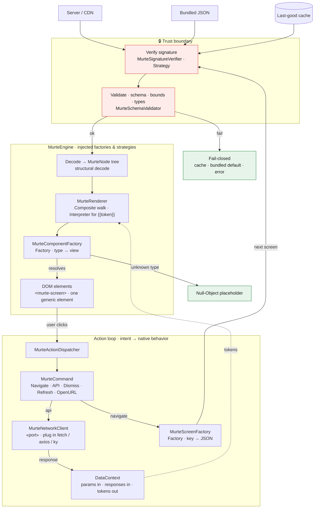

# Murte

[](https://github.com/fajekrina/murte/actions/workflows/ci.yml)
[](https://fajekrina.github.io/murte/)
[](https://www.typescriptlang.org)
[](https://www.npmjs.com/package/murte)
[](https://github.com/fajekrina/murte)
[](LICENSE)

> A web-native **server-driven UI** framework — render screens from JSON,
> navigate and call APIs declaratively, extend with any third-party component,
> with fintech-grade validation and security.
>
> The web edition of [**Murti**](https://github.com/iQbalADR/murti) by iQbalADR:
> same architecture, same API shape, same payloads — rendered with the DOM instead
> of SwiftUI. See [NOTICE](NOTICE).

The server describes *what* a screen is; the client owns *how* it renders,
navigates, and talks to the network. Ship layout changes without a redeploy.
Deliberately **web-platform-only** — plain DOM, Custom Elements, WebCrypto, and
IndexedDB; no UI framework — a strength, not a limitation. Because it renders into
plain elements, a `<murte-screen>` drops into any React, Vue, Svelte, or plain page.

> **Status:** early development. The core engine (render + actions + validation +
> signature verification + versioned secure caching) is built and tested; APIs may
> still change before 1.0.

---

## Requirements

- An evergreen browser (Chrome, Edge, Firefox, Safari 17+) — Custom Elements,
  WebCrypto Ed25519, IndexedDB
- Node 20+ for building, testing, and `MurteGen`
- TypeScript 5 (optional; types ship with the package)

```sh
npm install murte
```

---

## Quickstart

```ts
import {
  MurteActionDispatcher, MurteComponentFactory, MurteEngine, MurteNavigator, MurteScreen,
  MurteScreenFactory, ScreenSource
} from 'murte'

// 1. Create the engine, giving it the component/screen factories and the action dispatcher.
const engine = new MurteEngine({
  componentFactory: MurteComponentFactory.withBuiltins,   // text, image, vstack, hstack, zstack, button, card
  screenFactory: new MurteScreenFactory().register('home', homeJSON),
  actionDispatcher: new MurteActionDispatcher({
    network: new MyNetworkClient(),                       // your adapter — see docs/networking.md
    navigator: new MurteNavigator({ navigate: (screen, params) => { /* push a route */ } })
  })
})

// 2. <murte-screen> loads the JSON registered for "home" and renders it.
document.querySelector('#app')!.append(MurteScreen.create(ScreenSource.key('home'), { engine }))
```

Or inject the engine once and use the element declaratively:

```ts
MurteScreen.define()
murteEngine(document.body, engine)        // nested <murte-screen>s pick it up
const screen = document.createElement('murte-screen') as MurteScreen
screen.source = ScreenSource.key('home')
```

### Add a component

```ts
// A) as a class — single file, testable
class RatingComponent implements MurteComponent {
  static readonly type = 'rating'
  makeView(node: MurteNode, context: MurteRenderContext): Node {
    return starRating(node.int('stars'))
  }
}
engine.componentFactory.register(new RatingComponent())

// B) inline — wrap ANY library in one line, no new class, no module
engine.componentFactory.register('lottie', (node) => lottiePlayer({ animation: node.string('name') }))
```

The JSON author then writes `{ "type": "rating", "props": { "stars": 4 } }` or
`{ "type": "lottie", "props": { "name": "success" } }` — and never knows the
library exists. An unregistered type degrades to a safe placeholder, never a crash.

---

## Architecture

One request travels through a **render pipeline** (top → bottom) and comes back
through an **action loop** (bottom → top). Every box is annotated with the design
pattern it embodies.



### Reading the diagram

| Pattern | Where it lives | What varies |
| --- | --- | --- |
| **Factory / Abstract Factory** | `MurteComponentFactory`, `MurteScreenFactory` | a `type`/`key` string → an object |
| **Command** | `MurteCommand` set (Navigate, API, Dismiss, Refresh, OpenURL) | each action is self-contained; closed vocabulary, no logic in JSON |
| **Strategy / Ports & Adapters** | `MurteNetworkClient`, `MurteSignatureVerifier`, `MurteCacheStore`, `MurteCacheCipher` | plug in an implementation without touching core |
| **Composite + Interpreter** | `MurteRenderer` | walk the `MurteNode` tree; resolve `{{token}}` against the data context |
| **Null Object** | unknown-component fallback | a safe placeholder — never a crash, forward-compatible |
| **Dependency Injection** | `MurteEngine` | receives its factories/strategies; no global singletons → testable |

**Safety rails baked into the path:** the 🔒 trust boundary verifies before
anything is trusted, validation is bounded to prevent DoS, unknown components
degrade to a Null-Object placeholder, and any failure is **fail-closed** —
last-good cache, bundled default, or an error state, never a blank screen or a
crash.

### From Murti to Murte

| Murti (SwiftUI) | Murte (web) |
| --- | --- |
| `MurtiScreen` (a SwiftUI `View`) | `<murte-screen>` (a Custom Element), `MurteScreen.create(…)` |
| `.murtiEngine(_:)` environment | `murteEngine(ancestor, engine)` |
| `@Observable DataContext` | `DataContext.subscribe` — the screen re-renders on change |
| `AnyView` from `makeView` | a DOM `Node` from `makeView` |
| SF Symbols (`systemName`) | `MurteSymbols` — the same names, inline SVG |
| CryptoKit Ed25519 / AES-GCM | WebCrypto Ed25519 / AES-GCM (async) |
| `FileCacheStore` (Data Protection) | `IndexedDBCacheStore` (origin-isolated) |
| `#if DEBUG` | `MurteBuild.debug` |
| `Data` | `Uint8Array` (strings accepted as UTF-8) |

---

## Modules

| Module | Import | Role | Dependencies |
| --- | --- | --- | --- |
| `MurteCore` | `murte` | Engine, registries, renderer, validation, signing, caching | **zero** third-party |
| `MurteBuilder` | `murte/builder` | TypeScript DSL → payload JSON, and `DSLExport` back | `MurteCore` |
| `MurteGen` | `npm run gen` | Build-time JSON generation | `MurteBuilder` (Node) |
| `MurteStudio` | `npm run studio` | Visual editor | `MurteCore`, `MurteBuilder` |
| `MurteGallery` | `npm run gallery` | Runnable component gallery | `MurteCore` |

Networking libraries (fetch / axios / ky) plug into the `MurteNetworkClient`
**port** as a small adapter in your app — see [docs/networking.md](docs/networking.md)
— not a Murte package. Wrapping **any** library is one self-registering component
(or the one-line function above).

---

## Networking

`MurteCore` ships **no** network client — only the `MurteNetworkClient` port. Plug
in `fetch`, axios, or ky as a ~15-line adapter; swap libraries by swapping the
adapter and nothing else changes. [docs/networking.md](docs/networking.md) has the
diagram + ready adapters.

## Security

Signing is a toggle — insecure-by-default *by name*, so an unsigned production
build is obvious in review:

```ts
new MurteEngine({ …, security: PayloadSecurity.insecureDevelopment })   // dev: unsigned payloads OK

const verifier = await Ed25519Verifier.create(embeddedPublicKey)
new MurteEngine({ …, security: PayloadSecurity.signed(verifier) })      // prod: require + verify
```

Verification runs on **every** load — including from cache — so a poisoned cache
is caught, not just a bad download. Plus bounded validation (depth / node / chain
caps) and the closed action vocabulary. The framework provides the *mechanisms*;
you own key management and endpoints — it never claims to be "secure" for you.

## Caching

`MurteCore` ships an optional, signed, versioned cache — off unless you wire it:

```ts
new MurteEngine({ …, cache: new MurteCache({ store: new IndexedDBCacheStore(), cipher: new PassthroughCipher() }) })
```

Call `await engine.refreshManifest()` (adopter-triggered) to pull the signed
version manifest — which version of each screen is current. The cache is three
tiers: an in-memory decoded-node tier, and a persistent tier of signed envelopes
(IndexedDB, optionally encrypted via `AESGCMCipher`), driven by the manifest and
keyed by `screenKey@version`. Every persistent load **re-verifies the signature**
before use — fail-closed, so a poisoned entry is evicted, never rendered. Offline,
the last-good version is served (itself re-verified). Warm a key ahead of
navigation with `await engine.prefetch(['home'])`.

## Demo — the gallery

`MurteGallery` is a runnable Storybook: every component, a JSON/Preview toggle, an
action banner that shows dispatched actions, and a paste-JSON hot-reload harness.

```
npm run gallery
```

## Develop

```
npm install
npm run typecheck
npm test            # Vitest (jsdom)
npm run build       # dist/murte-core.js, dist/murte-builder.js + types
npm run build:apps  # Gallery, Studio, preview app
```

## Docs

- [Authoring guide](docs/guide.md) — start here: the three ways to write a screen,
  the component vocabulary, tokens, actions, and validation.
- [The DSL & MurteGen](docs/authoring.md) — the MurteBuilder DSL for writing
  screens in TypeScript, and MurteGen for build-time JSON generation. **Primary path.**
- [Visual editor](docs/studio.md) — MurteStudio, a web app that edits the node
  tree by direct manipulation and exports validated JSON. **Primary path.**
- [Figma export](docs/figma.md) — *experimental.* A Figma plugin that turns a frame
  into rough scaffolding (not a pixel-accurate conversion); prefer the DSL or
  MurteStudio above for real screens.
- [Payload schema & validation](docs/schema.md) — the authoritative JSON Schema,
  `schemaVersion` policy, bounds, and valid/invalid fixtures.
- [Networking adapters](docs/networking.md) — the port + fetch / axios / ky adapters.
- [Contributing](CONTRIBUTING.md).

## License

[Apache-2.0](LICENSE). Murte is derived from [Murti](https://github.com/iQbalADR/murti),
Copyright 2026 iQbalADR, under the same license — see [NOTICE](NOTICE).
