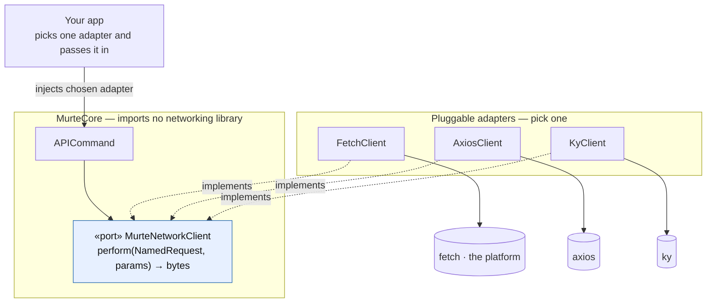

# Networking — a port you plug into, not a client Murte builds

Murte does **not** build, ship, or force a network client. `MurteCore` imports
**no** networking library. It defines one **port** (an interface), and you plug in an
**adapter** that wraps whatever you already use — plain **`fetch`**, **axios**, or
**ky**. Swap libraries by swapping the adapter; the engine never changes.

This is the Strategy / Ports-and-Adapters pattern (dependency inversion): the
engine depends on the abstraction, each adapter depends on the abstraction *and* a
library, and your app picks which adapter to inject.

## The port (all `MurteCore` defines)

```ts
export interface MurteNetworkClient {
  perform(request: NamedRequest, params: MurteProps): Promise<Uint8Array>
}
```

The whole contract: given an allow-listed named request + params, return the
response bytes. Library types (`AxiosError`, ky's `HTTPError`) never cross this
boundary — failures surface as `MurteError.network(status)`.

## The picture



Core points **only** at the port. Adapters point at the port (implement) and at a
library (wrap). Your app is the only place that names a concrete library.

## Adapters (pick one — ~15 lines each)

Each maps `NamedRequest` → your real endpoint (the app owns that mapping and its
auth; Murte can't know them).

### `fetch` — zero third-party dependencies

```ts
import { MurteError, type MurteNetworkClient, type MurteProps, type NamedRequest } from 'murte'

export class FetchClient implements MurteNetworkClient {
  constructor(private readonly baseURL: string, private readonly headers: HeadersInit = {}) {}

  async perform(request: NamedRequest, params: MurteProps): Promise<Uint8Array> {
    const endpoint = Endpoints.build(request, params, this.baseURL)   // → URL + method + body
    const response = await fetch(endpoint.url, { method: endpoint.method, body: endpoint.body, headers: this.headers })
      .catch(() => { throw MurteError.network(null) })
    if (!response.ok) throw MurteError.network(response.status)
    return new Uint8Array(await response.arrayBuffer())
  }
}
```

### axios — interceptors for auth

```ts
import axios, { type AxiosInstance } from 'axios'
import { MurteError, type MurteNetworkClient, type MurteProps, type NamedRequest } from 'murte'

export class AxiosClient implements MurteNetworkClient {
  constructor(private readonly http: AxiosInstance) {}   // axios.create({ baseURL, … }) + interceptors

  async perform(request: NamedRequest, params: MurteProps): Promise<Uint8Array> {
    const endpoint = Endpoints.build(request, params)
    try {
      const response = await this.http.request({ url: endpoint.url, method: endpoint.method, data: endpoint.body, responseType: 'arraybuffer' })
      return new Uint8Array(response.data)
    } catch (error) {
      throw MurteError.network(axios.isAxiosError(error) ? error.response?.status ?? null : null)
    }
  }
}
```

### ky — retries and hooks

```ts
import ky, { HTTPError, type KyInstance } from 'ky'
import { MurteError, type MurteNetworkClient, type MurteProps, type NamedRequest } from 'murte'

export class KyClient implements MurteNetworkClient {
  constructor(private readonly http: KyInstance) {}   // ky.create({ prefixUrl, retry, hooks })

  async perform(request: NamedRequest, params: MurteProps): Promise<Uint8Array> {
    const endpoint = Endpoints.build(request, params)
    try {
      return new Uint8Array(await this.http(endpoint.url, { method: endpoint.method, json: endpoint.json }).arrayBuffer())
    } catch (error) {
      throw MurteError.network(error instanceof HTTPError ? error.response.status : null)
    }
  }
}
```

## Wiring (at app startup)

```ts
const client: MurteNetworkClient = new AxiosClient(authedAxios)

const engine = new MurteEngine({
  componentFactory: MurteComponentFactory.withBuiltins,
  screenFactory: screens,
  actionDispatcher: new MurteActionDispatcher({ network: client, navigator })
})
```

Swap `AxiosClient` for `KyClient` or `FetchClient` — nothing else in the app
changes. That is the plug.

## Same pattern everywhere

Components (Lottie, charts) plug into `MurteComponent`, signature verification into
`MurteSignatureVerifier`, caching into its own port. Murte defines the interface;
you plug in the implementation. Nothing library-specific ever lives in `MurteCore`.
